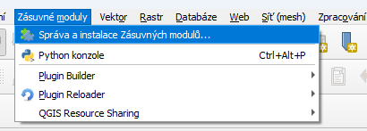

# Instalace z QGIS Plugin repozitáře

Spusťte QGIS a klikněte na menu "Zásuvné moduly" -> "Správa a instalace Zásuvných modulů ...". 

V otevřeném dialogovém okně přejděte do záložky "Not installed". 
Napište klíčové slovo "DTM" a stiskněte Enter. 
Zobrazí se jeden nalezený plugin s názvem JVF DTM Plugin.
V dalším kroku klikněte na tlačítko "Instalovat zásuvný modul" v pravém dolním rohu.

# Instalace z GitHubu (pro testování jiných verzí pluginu)

Plugin si nejprve stáhněte z GitHubu jako ZIP soubor.
Dále spusťte QGIS a klikněte na menu "Zásuvné moduly" -> "Správa a instalace Zásuvných modulů ...".
V otevřeném dialogovém okně přejděte do záložky "Instalovat ze ZIPu". 
Najděte ZIP soubor s pluginem a klikněte na "Instalovat zásuvný modul".

# Požadavky na Linuxu

Plugin používá Python modul **pandas**. Instalace QGIS pro Windows ho obsahuje, na Linuxu ale QGIS používá systémový Python a modul je nutné nainstalovat zvlášť. Bez něj plugin při spuštění QGIS skončí chybou `ModuleNotFoundError: No module named 'pandas'`.

Modul nainstalujte balíčkovým systémem distribuce, například:

```
# Debian, Ubuntu, Linux Mint
sudo apt install python3-pandas

# Fedora
sudo dnf install python3-pandas

# Arch Linux
sudo pacman -S python-pandas
```

Pokud máte QGIS nainstalovaný jako Flatpak, používá vlastní Python a systémový balíček nestačí. Modul pak nainstalujte do prostředí Flatpaku:

```
flatpak run --command=pip3 org.qgis.qgis install --user pandas
```

Po instalaci modulu QGIS restartujte. Zda je modul dostupný, ověříte v Python konzoli QGIS (*Zásuvné moduly → Python konzole*) příkazem `import pandas`.
