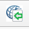
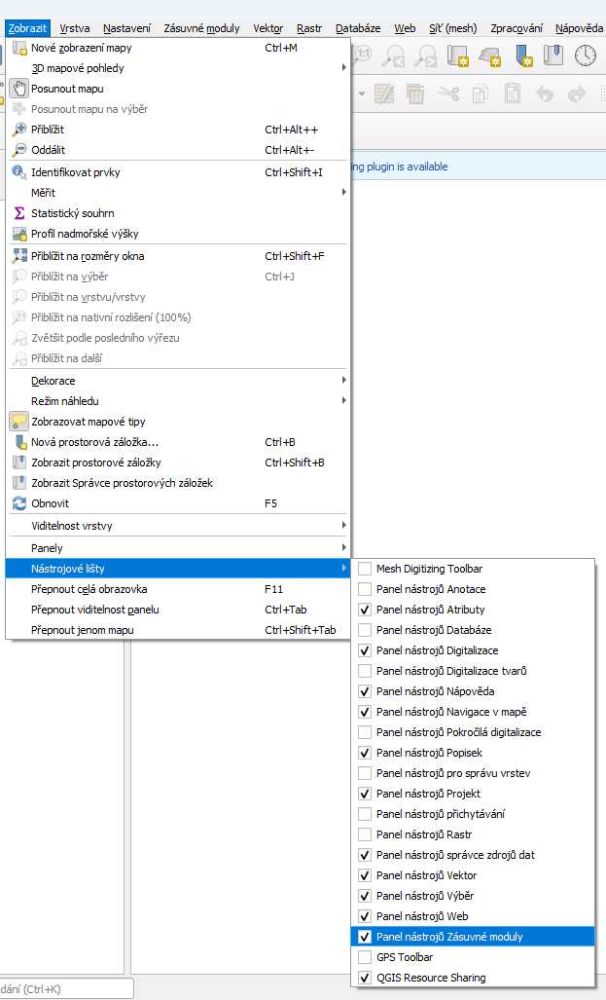
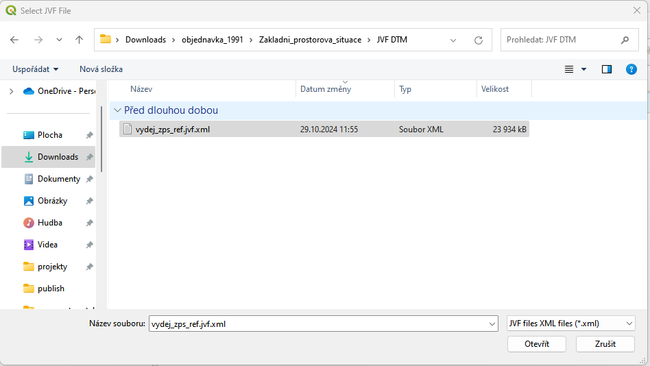
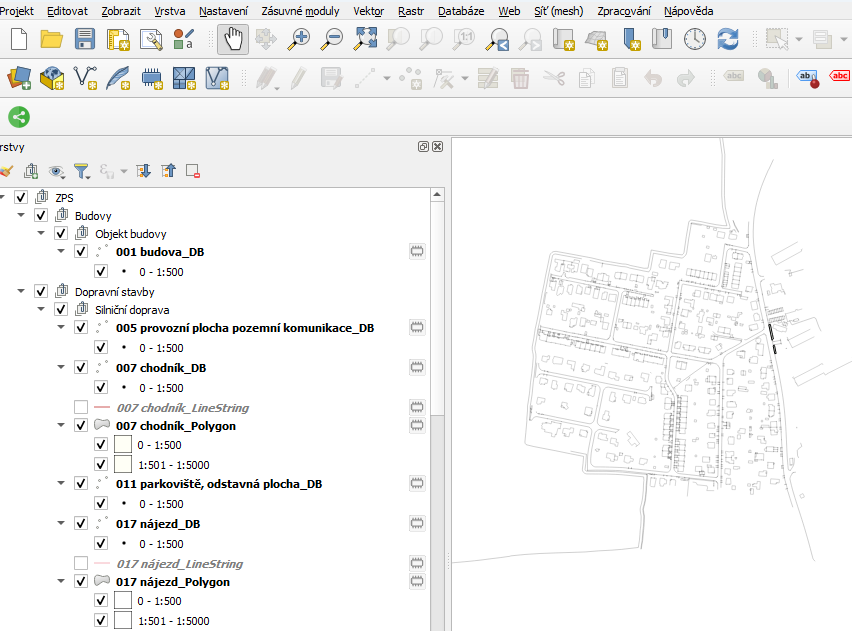
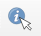
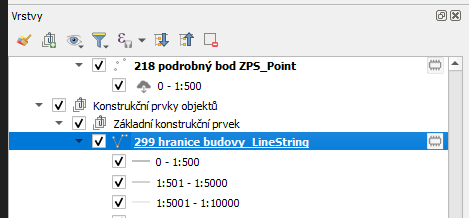
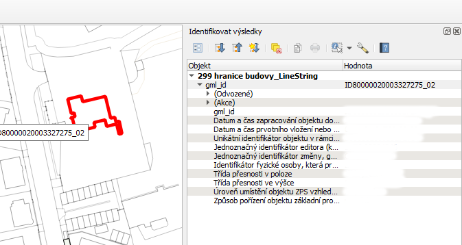

# Použití

Klikněte na ikonku 
.

Pokud tuto ikonku nevidíte, klikněte na menu "Zobrazit" -> "Nástrojové lišty" a zatrhněte "Panel nástrojů Zásuvné moduly"
.

Po kliknutí na ikonku na Vás vyskočí následující dialogové okno:
.

Otevřete požadovaný JVF soubor a vyčkejte až se načte.

Výsledek může vypadat například takto:
.

Pokud chcete vidět atributy konkrétního objektu, klikněte na tuto ikonu:
.
vyberte vrstvu nebo skupinu, která Vás zajímá
.

Vybraný objekt (objekty) se zvýrazní červeně a vyskočí na Vás následujcí panel "Identifikovat výsledky" se seznamem atributů objektu (objektů):
.

## Více geometrií u jednoho objektu

Pokud má objekt v JVF souboru dvě geometrie (např. definiční bod a plochu), načte se každá geometrie do vlastní vrstvy ve stejné skupině. Obě vrstvy jsou po načtení zaškrtnuté a zobrazené. Vrstva s druhou geometrií má v názvu navíc typ geometrie (např. `_Polygon`), nemá předdefinovaný styl, a proto se vykreslí náhodnou barvou ve všech měřítkách. Pokud ji nechcete zobrazit (ani exportovat), odškrtněte ji v panelu vrstev.

## Export

Načtená data lze uložit do GeoPackage nebo DXF druhou ikonou pluginu **JVF DTM Viewer - export to DXF or GeoPackage**

(je také v menu *Vektor → JVF DTM Viewer*).
Postup a popis toho, co se při exportu děje, najdete na stránce [Export do GeoPackage a DXF](export.md).
